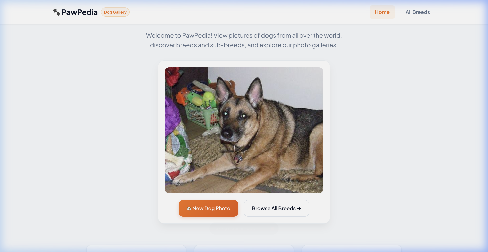
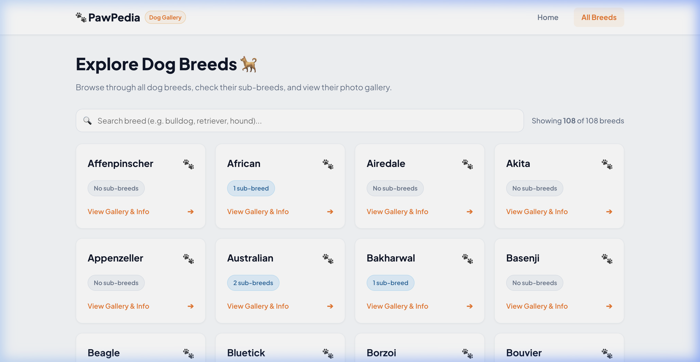
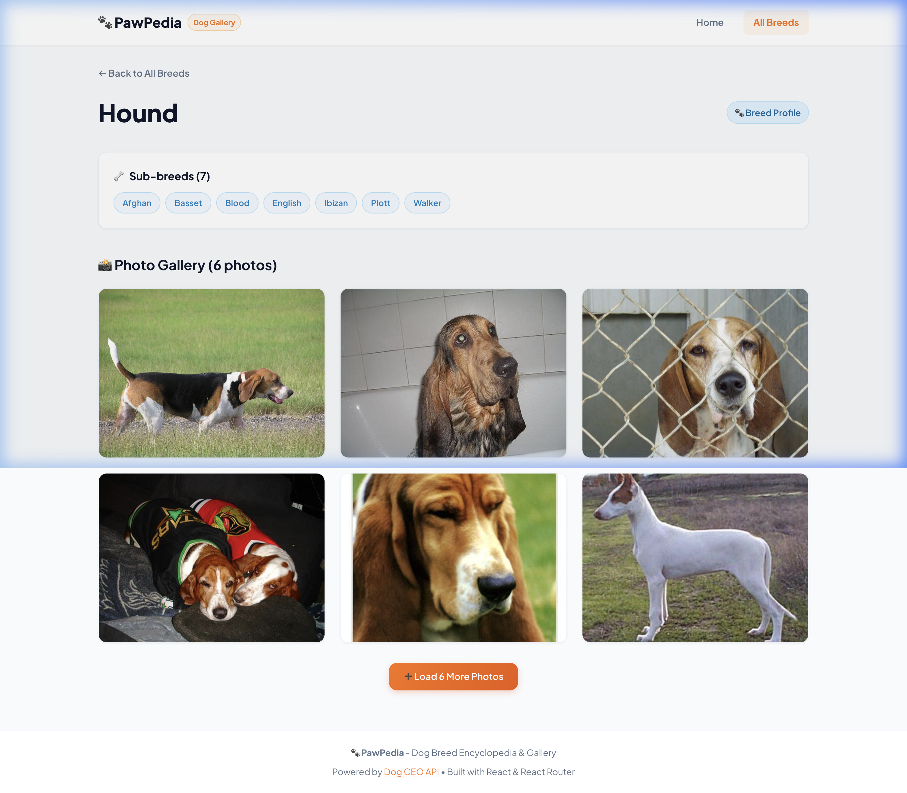
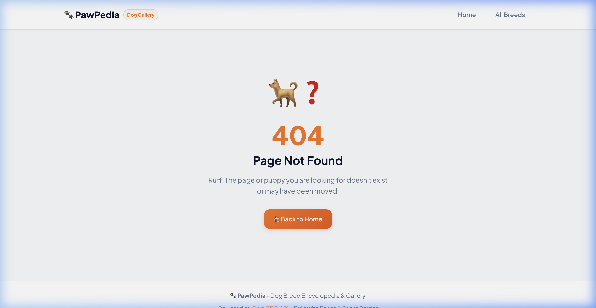

# PS9: PawPedia - Dog Breed Gallery & Encyclopedia 🐾

PawPedia is a clean, modern, beginner-friendly React application built with **React** and **React Router**. It allows dog lovers and researchers to explore dog breeds, inspect sub-breed variations, and browse high-resolution photo galleries using the free Dog CEO REST API.

---

## 📌 Project Overview

- **Problem Statement:** PS9 - PawPedia: Dog breed gallery
- **Tech Stack:** React 19, React Router v7, Vite, Vanilla CSS
- **API Used:** [Dog CEO REST API](https://dog.ceo/dog-api/) (Free, no API key required)
- **Live Deployment:** [Deploy on Vercel](#-deployment-instructions)

---

## 🧭 Routes & Features

| Route | Page / View | API Endpoint Used | Description |
| :--- | :--- | :--- | :--- |
| `/` | **Home Page** | `https://dog.ceo/api/breeds/image/random` | Hero section displaying a random dog photo. Includes a **"🐶 New Dog Photo"** button to fetch another random dog on demand and a direct link to explore breeds. |
| `/breeds` | **All Breeds Directory** | `https://dog.ceo/api/breeds/list/all` | Lists all dog breeds in cards with their respective sub-breed count badge. Features real-time search filtering. |
| `/breeds/:breed` | **Breed Details & Gallery** | `https://dog.ceo/api/breed/:breed/list` & `https://dog.ceo/api/breed/:breed/images/random/6` | Shows the selected breed's name, registered sub-breed tags, and an initial 6-photo gallery. Includes a bonus **"➕ Load 6 More Photos"** button. |
| `*` | **404 Page Not Found** | None | Friendly 404 error page with an illustration and button to navigate back to the home page. |

---

## 📸 Screenshots

### 1. Home Page (Hero with Random Dog Photo)


### 2. All Breeds Page (Search & Breed Cards)


### 3. Breed Details & Photo Gallery (`/breeds/hound`)


### 4. 404 Not Found Page


---

## 🛠️ Project Setup & Local Run

### Prerequisites
- Node.js (v18+ recommended)
- npm or yarn

### Installation Steps

1. **Clone the repository:**
   ```bash
   git clone <your-repo-url>
   cd ps9-pawpedia
   ```

2. **Install dependencies:**
   ```bash
   npm install
   ```

3. **Start development server:**
   ```bash
   npm run dev
   ```
   Open `http://localhost:5173` in your browser.

4. **Build for production:**
   ```bash
   npm run build
   ```

---

## 🚀 Deployment Instructions

### Vercel Deployment
A `vercel.json` file is already included in the root directory to ensure client-side routing works without 404s on direct URL reloads (e.g., `/breeds/hound`):

```json
{
  "rewrites": [
    {
      "source": "/(.*)",
      "destination": "/"
    }
  ]
}
```

1. Push your repository to GitHub.
2. Import the repository in [Vercel](https://vercel.com).
3. Set the Framework Preset to **Vite**.
4. Click **Deploy**.

---

## 💡 Code Highlights & Architecture

- **Clean & Beginner-Friendly Code:** Plain React state (`useState`), effect hooks (`useEffect`), and native `fetch` with clear error handling.
- **Dynamic Routing:** Route parameter retrieval via `useParams()` from `react-router-dom`.
- **Responsive UI:** Custom responsive CSS grid layout that adapts seamlessly across mobile, tablet, and desktop screens.
